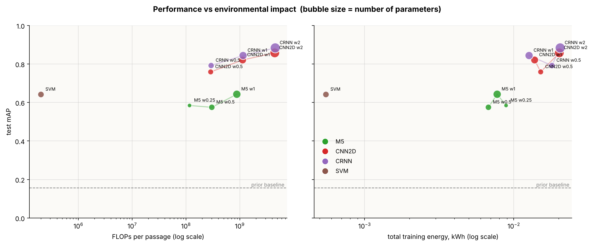
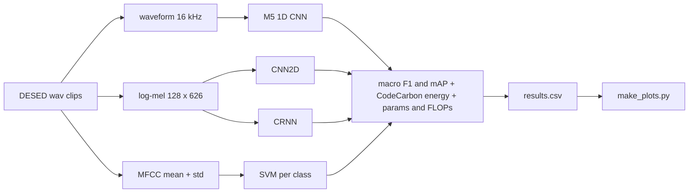
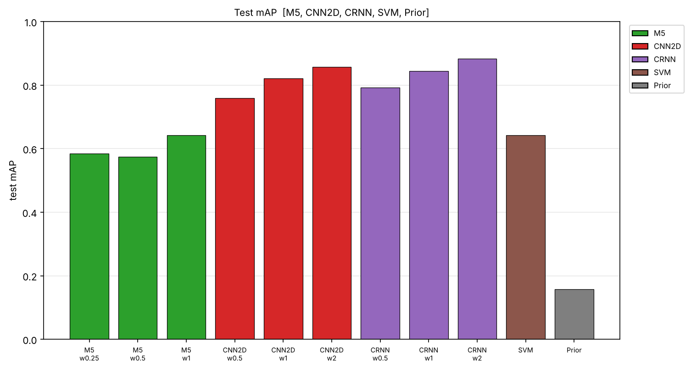
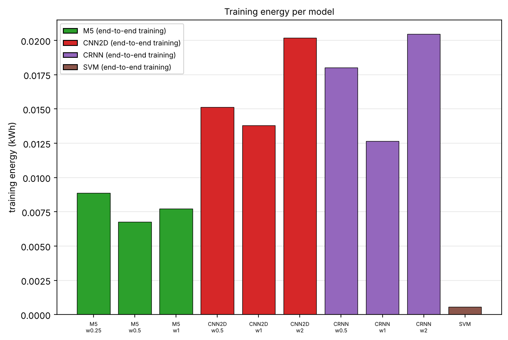
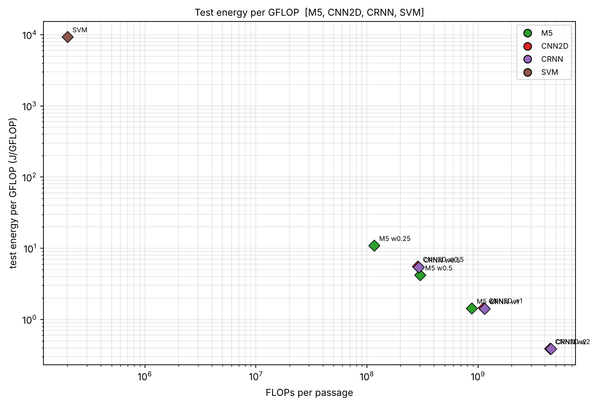

# 🌱 AI-and-EI-Scratch

Link : [GitHub](https://github.com/MomoxSupreme/AI-and-EI/tree/Scratch)

> **Performance vs. environmental impact in deep learning: how much energy does a better audio classifier cost?**


-informational)

A small, reproducible benchmark that trains **four families of models from scratch** on one task, **sound event tagging on DESED**, and measures not only *how well* they predict but also *what they cost*: parameters, FLOPs, and the energy used for training and inference.

> 🗓️ **Recent project.** Built in November 2026 as a hands-on way to practise rigorous ML evaluation and Green AI measurement. It is a working snapshot rather than a polished library, and the [limitations](#-limitations--next-steps) are listed honestly below.
>
> 🤖 **AI assistance was used** for code review, comments and documentation lookup, and also for parts of the code. See [How AI was used](#-how-ai-was-used) for the precise breakdown.

---

## ✨ At a glance



*Test mAP against compute (left) and training energy (right). Bubble size is the number of parameters; lines connect the widths of one architecture; the dashed line is a "predict class frequencies" baseline.*

**What the first results suggest** (single run per model, see the caveats below):

- 🎛️ **Representation matters at equal compute.** At about 0.3 GFLOPs per clip, the log-mel CNN reaches mAP 0.76, against 0.58 for the raw-waveform M5 (288 vs 302 MFLOPs).
- 🔁 **A GRU on top of the CNN helps a little but consistently**: +0.02 to +0.03 mAP at each of the three widths tested.
- 🍃 **The classic baseline is the energy outlier.** An MFCC + SVM pipeline matches the best waveform CNN (mAP 0.64) with about 14× less training energy.
- 🔋 **Energy did not scale with model size.** The networks' training energy stayed within a factor of 3 (about 7 to 20 Wh) and test energy per clip was nearly flat (about 3.5 to 5 × 10⁻⁷ kWh), which hints that audio loading and preprocessing dominate the measurements (hypothesis, not isolated yet).

---

## 🧪 The models

| Family | Input | What it is | Widths tested |
|---|---|---|---|
| **M5** | raw waveform (16 kHz, 10 s) | 1D CNN, strided first conv, mean + max pooling over time | 0.25 / 0.5 / 1 |
| **CNN2D** | log-mel (128 × 626) | 2D CNN, time pooled in the first two blocks, input BatchNorm | 0.5 / 1 / 2 |
| **CRNN** | log-mel (128 × 626) | same CNN + bidirectional GRU, mean + max pooling over time | 0.5 / 1 / 2 |
| **SVM** | 20 MFCC (mean + std = 40 features) | one RBF SVM per class, `GridSearchCV` on C and gamma, balanced class weights | n/a |
| **Prior** | none | predicts each class's training frequency (the floor) | n/a |

`width` is a channel multiplier, so each architecture gives several points on the performance / cost curve. `CNN2D` vs `CRNN` at the same width isolates the effect of recurrence; `M5` vs `CNN2D` compares waveform and spectrogram front-ends, but representation, convolution type and pooling change together there.



---

## 📊 Results

Test split of DESED (weak labels, 10 classes). Metrics are macro-F1 at a 0.5 threshold and macro mAP. Energy is measured with CodeCarbon.

| Model | Width | Params | GFLOPs / clip | Train energy (Wh) | Test F1 | Test mAP |
|---|---|---|---|---|---|---|
| prior (class frequencies) | - | 10 | 0 | - | 0.000 | 0.157 |
| SVM (MFCC) | - | 97 k | ~0.0002 | 0.55 | 0.559 | 0.642 |
| M5 | 0.25 | 23 k | 0.12 | 8.88 | 0.311 | 0.585 |
| M5 | 0.5 | 88 k | 0.30 | 6.76 | 0.358 | 0.575 |
| M5 | 1 | 343 k | 0.88 | 7.74 | 0.439 | 0.643 |
| CNN2D | 0.5 | 63 k | 0.29 | 15.14 | 0.512 | 0.759 |
| CNN2D | 1 | 248 k | 1.13 | 13.79 | 0.695 | 0.821 |
| CNN2D | 2 | 984 k | 4.47 | 20.18 | 0.709 | 0.858 |
| CRNN | 0.5 | 82 k | 0.29 | 18.02 | 0.708 | 0.792 |
| CRNN | 1 | 322 k | 1.15 | 12.66 | 0.722 | 0.844 |
| **CRNN** | **2** | **1.28 M** | **4.56** | **20.46** | **0.782** | **0.884** |

<table>
<tr>
<td></td>
<td></td>
</tr>
<tr>
<td align="center"><i>Test mAP per model</i></td>
<td align="center"><i>Training energy per model</i></td>
</tr>
</table>



*Test energy per GFLOP against FLOPs per clip: it falls as models grow, because a roughly fixed per-clip cost (probably audio loading) is spread over more operations.*

### Why mAP and macro-F1 (and not accuracy)?

Each clip carries about 1.6 of the ten labels on average, so element-wise accuracy is around 84% for a model that never predicts anything. **mAP** judges the ranking of clips per class without any threshold, and **macro-F1** gives each class the same weight. The `prior` row shows the floor both metrics must beat.

---

## 🔬 Method, in short

- **Data.** DESED public evaluation set, weak labels (`public_weak.tsv`), 10 classes. Audio is converted to mono, resampled to 16 kHz and padded or cropped to 10 s. Log-mel uses `n_fft=2048`, `hop=256`, 128 mel bands (626 frames).
- **No leakage.** The training folder is split **by file** into train and validation (80/20, fixed seed). Early stopping and the learning-rate scheduler use only validation loss; the eval split is touched once, for the final test.
- **Training.** BCE-with-logits, Adam, `ReduceLROnPlateau`, early stopping. One shared training loop for all networks.
- **Cost measurement.** [CodeCarbon](https://github.com/mlco2/codecarbon) wraps training and testing separately. The test energy covers the whole path from the wav file to the prediction (loading, resampling, mel or MFCC), identically for every model. Parameters and FLOPs come from PyTorch's `FlopCounterMode` (batch of one, on CPU); SVM costs are estimated analytically from the support vectors.
- **Baseline.** The `prior` row, computed without reading any audio.

---

## 📂 Project structure

```text
AI-and-EI-Scratch/
├── Models/
│   └── models.py            # M5, CNN2D, CRNN (width-scalable) + SVM wrapper, built from modular blocks
├── Utils/
│   ├── config_reader.py     # Reads and parses config.ini
│   ├── datasets.py          # Datasets: waveform, log-mel, MFCC; by-file train/val split
│   ├── metrics.py           # Evaluation on a full loader: loss, macro-F1, mAP
│   ├── scheduler.py         # Early-stopping utility
│   ├── stats.py             # Parameter counts and FLOPs
│   └── visualize.py         # Progress bar and training curves
├── evaluate/
│   └── evaluate.py          # Runs the full benchmark (train, test, energy) and writes results.csv
├── assets/                  # Figures used in this README
├── config.ini               # Hyperparameters (epochs, learning rate, patience, paths...)
├── config.py                # Regenerates the default config.ini
├── training.py              # Training loop for all networks + SVM training
├── test.py                  # Inference / test metrics for trained models
├── make_plots.py            # Figures from results.csv (own results, or compared with another csv)
├── add_exact_match.py       # Optional: adds exact-match accuracy from saved checkpoints
├── requirements.txt
└── LICENSE
```

---

## ⚙️ Installation

1. **Clone the repository** (this work lives on the `scratch` branch):
   ```bash
   git clone <repository-url>
   cd <repository-folder>
   git checkout scratch
   ```

2. **Create and activate a conda environment** (recommended):
   ```bash
   conda create -n "name_of_your_env"
   conda activate "name_of_your_env"
   ```

3. **Install the dependencies:** (faster option)
   ```bash
   pip install -r requirements.txt
   ```
   **Or Install the dependencies with conda:** (safer option)

   ```bash
   conda install (*name_of_the_dependencies)
   ```

4. **Get the data.** Place the DESED public evaluation set as expected by `config.ini` (defaults):
   ```text
   Data/raw/audio/train/            Data/raw/audio/eval/
   Data/raw/metadata/train/public_weak.tsv
   Data/raw/metadata/eval/public_weak.tsv
   ```

---

## 🛠️ Configuration

Hyperparameters and paths live in `config.ini`: number of epochs, learning rate, optimizer, early-stopping patience, dataset paths. If you break it, `python config.py` regenerates the default file.

Experiment-level switches are at the top of `evaluate/evaluate.py`:

| Switch | Meaning |
|---|---|
| `WIDTHS` | widths tested for each family |
| `SEEDS` | `None` for the config seed, or e.g. `[0, 1, 2]` for repeated runs (the seed also changes the train/val split) |
| `SMOKE_TEST` | `True` runs one width per family for one epoch, to check the pipeline quickly |

---

## 🚀 Usage

```bash
python -m evaluate.evaluate     # trains and evaluates every model, writes results.csv
python make_plots.py mine       # figures/mine/*.png from your results.csv
```

Tip: start with `SMOKE_TEST = True` to check that everything runs before launching the full benchmark.

Optional:

```bash
python add_exact_match.py                    # adds exact-match accuracy to results.csv (no retraining)
python make_plots.py compare --mate pretrained_results.csv   # overlays the pretrained-encoder results (teammate's csv format)
```

`results.csv` is rewritten after every run, so an interrupted benchmark keeps its progress.

---

## ⚠️ Limitations & next steps

- **One run per model.** Differences of a few points can be noise; `SEEDS` supports repeated runs and the next step is to report mean and spread.
- **Very small test set** (65 clips), so every metric has a wide error bar.
- **Energy includes preprocessing.** Networks recompute audio loading and mel extraction every epoch while the SVM does it once, which penalises the networks. Caching features would separate compute from I/O.
- **Fixed 0.5 threshold** for F1 and no class-imbalance weighting in the networks, whereas the SVM uses balanced class weights; mAP is the fairest cross-model number here.
- **Hardware details are not reported yet**; energy numbers are comparable only on the same machine.
- **Planned:** a transformer model, per-class threshold tuning on the validation set, and a comparison with pretrained encoders (see below).

### 🤝 Companion work

This branch trains everything from scratch. A separate effort (another branch, by a teammate) benchmarks **pretrained encoders** (CED, Whisper) with linear / MLP heads or retrieval (RAG) on the same task; `make_plots.py compare` overlays both result files.

---

## 🤖 How AI was used

I used an AI assistant (Claude) throughout this project, and I want to be upfront about where:

- **Code review and debugging**: catching bugs and design flaws in my first versions (a validation set that was the same as the test set, a misleading accuracy metric, tensor shape mismatches, mislabelled plots).
- **Code generation and refactoring**: the unified training and test loops, the width-scalable model family, the evaluation harness and the plotting scripts were written with the AI from my specifications, then run, checked and adapted by me.
- **Comments, docstrings and documentation lookup**: explanations of library behaviour (PyTorch, torchaudio, CodeCarbon) and the structure of this README.

**My own contribution**: choosing the task and the benchmark design (models compared, metrics, energy protocol), the first implementations of the M5, CRNN and SVM pipelines, the dataset and feature extraction, the CodeCarbon measurement setup, running all the experiments on my machine, and deciding what to conclude from them.

---

## 👤 Author

**Louka Menard**, 3rd-year engineering student at Mines Nancy (computer science department), preparing a double degree M.Sc. Computer Engineering + Master 2 IA2VR (AI for vision and robotics). I am looking for an end-of-studies internship in **robotics**; energy-aware models matter on embedded and robotic platforms, where compute budgets are tight.

---

## 📄 License

This project is licensed under the terms specified in the [LICENSE](LICENSE) file.